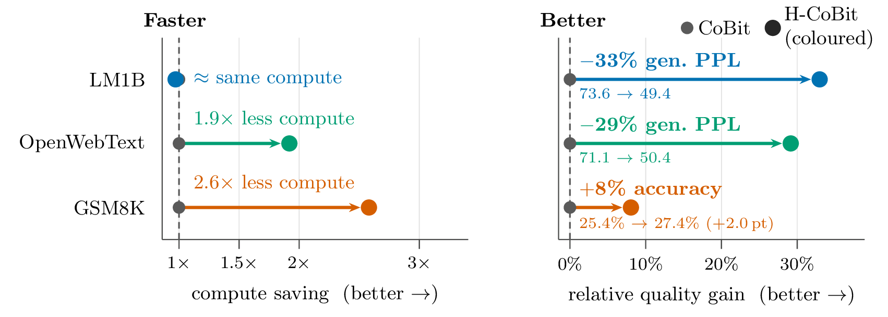

<h1 align="center">Hierarchical Continuous Diffusion Language Models</h1>

<p align="center">
  <b>Mathias Ollu</b><sup>1,2</sup> &nbsp;·&nbsp; <b>Nikos Komodakis</b><sup>2,3,4</sup>
  <br>
  <sup>1</sup>Ecole Polytechnique &nbsp; <sup>2</sup>Archimedes, Athena RC &nbsp; <sup>3</sup>University of Crete &nbsp; <sup>4</sup>IACM-Forth
</p>

<p align="center"><a href="https://arxiv.org/abs/2610.08738">arXiv:2610.08738</a></p>

<p align="center">
  
</p>

<p align="center"><sub>
<b>Better generations for less compute.</b> For each dataset, (left) the compute H-CoBit needs to match/surpass <i>CoBit's best results</i>, relative to CoBit's own cost; (right) the quality gain for optimal samplers. Gen-PPL is read at dataset entropy, GSM8K reports accuracy. LM1B is not budget-matched (CoBit 1M steps vs H-CoBit 600k).
</sub></p>

## Overview

We introduce **Hierarchical Continuous Diffusion Language Models (H-CDLMs)**, a simple framework that improves continuous diffusion language models with minimal compute and parameter overhead. We diffuse multiple modalities in parallel, representing tokens at different semantic granularities: the tokens themselves, and coarser *clusters* obtained by clustering pretrained token embeddings. Both modalities are jointly diffused and denoised by a single model, and samplers and noise schedules can be set per modality.

- **H-CoBit** applies the framework to [CoBit](https://arxiv.org/abs/2605.07013). At dataset entropy, it reaches a generative perplexity (GenPPL) of **49.4** on LM1B and **50.4** on OpenWebText, improving on the baseline by 24.2 and 20.7 points, and improves MAUVE on both. On GSM8K, it reaches **27.4%** accuracy, outperforming prior continuous diffusion and flow-based models.
- **H-FLM** applies the framework to the flow matching model [FLM](https://arxiv.org/abs/2602.16813), with consistent gains over FLM, showing that the framework generalizes across continuous generative paradigms.

## Results

GenPPL (GPT-2 Large) at dataset entropy $H$.

| Model | LM1B steps | NFE | $H$ | GenPPL ↓ | OWT steps | NFE | $H$ | GenPPL ↓ |
|---|---|---|---|---|---|---|---|---|
| CoBit-S | 1M | 128 | 4.34 | 85.2 | 750k | 256 | 5.46 | 83.2 |
| H-CoBit | 600k | 256 | 4.34 | 57.3 | 750k | 128 | 5.45 | 67.8 |
| CoBit-S, $s_\text{noise}=1.05$ | 1M | 256 | 4.34 | 73.6 | 750k | 256 | 5.46 | 71.1 |
| **H-CoBit + per-modality sampler** | 600k | 512 | 4.34 | **49.4** | 750k | 256 | 5.46 | **50.4** |

GSM8K accuracy, trained on TinyGSM.

| Model | NFE | Acc. (%) |
|---|---|---|
| CoBit-S | 512 | 23.4 |
| CoBit-S | 1024 | 25.4 |
| **H-CoBit** ($n=16$) | 512 | **27.4** |

## Code

- [`hcobit/`](hcobit): training and evaluation of H-CoBit and CoBit-S, with checkpoints and the paper's results (Tables 1, 2 and 11, Figure 4).
- `hflm/`: H-FLM, coming soon.

The H-CoBit checkpoints are on Hugging Face at [matol-16/hcdlm](https://huggingface.co/matol-16/hcdlm), and the CoBit-S baselines are CoBit's own release, [gbatzolis/CoBit](https://huggingface.co/gbatzolis/CoBit). To download them and reproduce a headline number:

```bash
cd hcobit
python scripts/prepare_data.py lm1b                                       # after the setup in hcobit/README.md
python scripts/download_checkpoints.py                                  # -> hcobit/checkpoints/
python evaluate.py genppl lm1b hcobit_pms --nfe 512 --gamma 0.3          # Table 1: GenPPL 49.4 at H = 4.34
```

The commands for every result are in [`hcobit/README.md`](hcobit/README.md#reproduce-the-papers-results-from-the-released-checkpoints).

## Acknowledgements

This work builds on [CoBit](https://arxiv.org/abs/2605.07013) (Batzolis et al., 2026) and [FLM](https://arxiv.org/abs/2602.16813) (Lee et al., 2026). Cluster maps are computed from the pretrained token embeddings of [LangFlow](https://github.com/nealchen2003/LangFlow) (LM1B, OpenWebText) and [S-FLM](https://github.com/jdeschena/s-flm) (TinyGSM); [`hcobit/README.md`](hcobit/README.md#cluster-maps) shows how to rebuild them.

## License

This repository is released under the [MIT License](LICENSE). Code derived from CoBit keeps its original MIT notice, and code derived from FLM keeps its original Apache-2.0 license.

## Citation

```bibtex
@misc{ollu2026denoisinghierarchicalrepresentationsjoint,
      title={Denoising Hierarchical Representations: Joint Continuous Diffusion for Language Modeling},
      author={Mathias Ollu and Nikos Komodakis},
      year={2026},
      eprint={2610.08738},
      archivePrefix={arXiv},
      primaryClass={cs.CL},
      url={https://arxiv.org/abs/2610.08738},
}
```
